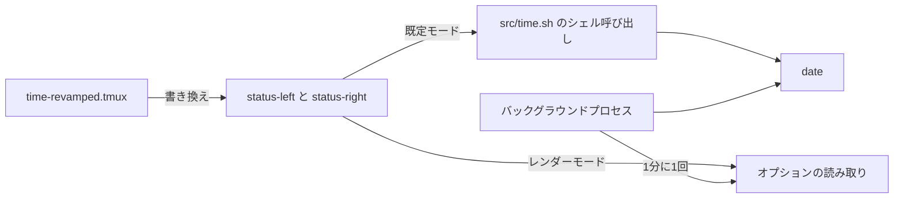

<div align="center">

# tmux-time-revamped

<strong>ステータスバーにローカル時計と世界時計を時間帯ごとの色で表示し、カウントダウンと夏時間の警告も出します。</strong>

[English](README.md) | 日本語 | [简体中文](README.zh-Hans.md) | [繁體中文（香港）](README.zh-HK.md)

[](https://github.com/tmux-revamped/tmux-time-revamped/actions/workflows/tests.yml)
[](LICENSE)
[](CHANGELOG.md)

<p align="center">
  <a href="#機能">機能</a> |
  <a href="#動作要件">動作要件</a> |
  <a href="#インストール">インストール</a> |
  <a href="#使い方">使い方</a> |
  <a href="#設定">設定</a> |
  <a href="#キーバインド">キーバインド</a> |
  <a href="#仕組み">仕組み</a>
</p>

</div>

ステータスのプレースホルダーが**14**個。操作が**4**つで、既定で割り当てるのはそのうち**1**つです。どの時計もシステムの`date`とタイムゾーンデータベースから求め、geoipを有効にしない限りネットワークには接続しません。

---

## 機能

このプラグインは、`status-left`と`status-right`のプレースホルダーを、ローカルの日付と時刻、任意の数の世界時計、開発やカレンダー向けのいくつかの項目に置き換えます。世界時計はそれぞれ現地の時刻に応じて色が付くので、誰が朝で誰が寝ている時間かが一目で分かります。

| プレースホルダー | 出力 |
|:------------|:-------|
| `#{time}` | ローカルの日付と時刻。例: `2026-10-16 14:30` |
| `#{time_date}` | ローカルの日付のみ |
| `#{time_clock}` | ローカルの時刻のみ |
| `#{time_zones}` | 設定したタイムゾーンごとに1項目、時間帯ごとの色付き |
| `#{time_local}` | 世界時計と同じ見た目のローカル時計。場所のラベル付き |
| `#{time_until}` | 目標日時までのカウントダウン。例: `1d 4h` |
| `#{time_elapsed}` | ストップウォッチのマークからの経過時間。例: `12m` |
| `#{time_epoch}` | UNIX時間の秒数 |
| `#{time_iso}` | ISO 8601形式のローカル時刻。例: `2026-10-16T14:30:00-04:00` |
| `#{time_offset}` | ローカルのUTCオフセット。例: `UTC-04:00`、または`UTC` |
| `#{time_week}` | ISO 8601の週番号 |
| `#{time_doy}` | 年初からの通算日 |
| `#{time_dst}` | 時刻の切り替えが期間内にあれば`DST in 3d` |
| `#{time_overlap}` | 設定した全ゾーンに共通する勤務時間帯をローカル時刻で表示 |

## 動作要件

| ツール | バージョン | 用途 |
|:-----|:--------|:---------|
| tmux | 3.2以降 | カレンダーのポップアップが`display-popup`を使います |
| bash | 3.2以降 | macOSの`/bin/bash`で動きます |
| `date`とタイムゾーンデータベース | システム | すべての時計。GNUとBSDの`date`に対応します |
| `cal` | システム | カレンダーのポップアップ |
| `curl` | 任意 | geoipによる場所のラベル |
| `pbcopy`、`wl-copy`、`xclip` | 任意 | タイムスタンプをシステムのクリップボードにコピー |

CIは、Ubuntu LTSのx86_64とarm64でGNUとuutilsのcoreutilsを使い、macOSのApple SiliconとIntelでシステムのツール、GNUのツール、uutilsを使ってテストを実行します。

## インストール

[TPM](https://github.com/tmux-plugins/tpm)を使う場合は、プラグインとプレースホルダーを`~/.tmux.conf`に追加して`prefix + I`を押します。

```tmux
set -g @plugin 'tmux-revamped/tmux-time-revamped'
set -g status-right '#{time}'
```

TPMを使わない場合は、リポジトリをクローンし、`status-right`を設定した後でエントリーポイントを実行します。

```bash
git clone https://github.com/tmux-revamped/tmux-time-revamped ~/.tmux/plugins/tmux-time-revamped
```

```tmux
run-shell ~/.tmux/plugins/tmux-time-revamped/time-revamped.tmux
```

## 使い方

```tmux
set -g @time_revamped_timezones 'America/New_York, Europe/London, Asia/Tokyo'
set -g status-right '#{time} #{time_zones}'
```

ローカルの時計がニューヨークの場合、ステータスバーの右側は次のようになります。

```text
2026-10-16 14:30 EDT 14:30 BST 19:30 JST 03:30
```

世界時計にはそれぞれ色が付きます。朝、昼、午後、夕方、夜の色か、土曜と日曜は週末の色です。

### 世界時計の装飾

| 設定 | 効果 |
|:--------|:-------|
| `@time_revamped_compact '1'` | ゾーンの略称の代わりに短い都市名。`America/New_York`は`NY`、`Asia/Tokyo`は`Tok` |
| `@time_revamped_zone_labels 'NYC, LDN, TYO'` | 自分で付けたラベル。順番でゾーンに対応します |
| `@time_revamped_relative_day '1'` | 日付が異なるゾーンに`+1d`か`-1d`のバッジ |
| `@time_revamped_work_hours '1'` | `@time_revamped_work_start`から`@time_revamped_work_end`の外にあるゾーンを薄く表示 |
| `@time_revamped_primary '0'` | 0から数えたその番号のゾーンを太字で表示 |

`#{time_overlap}`は設定した全ゾーンの勤務時間の重なりを求め、最も長い共通の時間帯をローカル時刻で表示します。例: `overlap 13:00-17:00`。共通の時間がなければ、ラベルに続けて`@time_revamped_overlap_none`を表示し、既定では`overlap no overlap`となります。

### 現在地のラベル

`#{time_local}`には場所の名前が必要です。既定では`TZ`か`/etc/localtime`のリンクから都市名をオフラインで取ります。`@time_revamped_local_source 'geoip'`にすると、代わりに`@time_revamped_geoip_endpoint`にグローバルIPの都市を問い合わせます。この要求は`@time_revamped_geoip_interval`分ごとにバックグラウンドで実行され、3秒でタイムアウトし、失敗すれば最後の都市を使い続けます。IPアドレスがエンドポイントに送られるので、それを許容できる場合にのみ有効にしてください。都市名は、英字、数字、空白、UTF-8の文字、`. , ' -`だけからなる64文字以下のものだけを受け付けます。

### カウントダウン、ストップウォッチ、夏時間

`#{time_until}`は、`YYYY-MM-DD`か`YYYY-MM-DD HH:MM`の形式で書いた`@time_revamped_countdown_target`までを数えます。目標を過ぎると`@time_revamped_countdown_done`を表示します。`#{time_elapsed}`は、マーク操作で設定したマークからの時間を数えます。`#{time_dst}`は、`@time_revamped_dst_zone`かローカルゾーンのUTCオフセットを`@time_revamped_dst_horizon`日先まで1日ずつ調べ、最初の変化を報告します。

### レンダーモード

既定では各プレースホルダーは`#()`呼び出しになり、tmuxはステータスを再描画するたびにそれを実行し直します。`@time_revamped_render`を`options`にすると、各プレースホルダーは`#{E:@time_revamped_out_local}`のようなオプションの読み取りになります。そしてサーバーごとに1つのバックグラウンドプロセスが、ステータスラインで使う時計をすべて、分が変わった1秒後に1分に1回描画し、1回のtmux呼び出しで書き込むので、時計がそろって変わります。

```tmux
set -g @time_revamped_render 'options'
```

## 設定

| オプション | 既定値 | 意味 |
|:-------|:--------|:--------|
| `@time_revamped_date_format` | `YMD` | `YMD`、`MD`、`DM`、`MDY`、`DMY`、`hide` |
| `@time_revamped_time_format` | `24H` | `24H`、`12H`、`hide`。ローカル時計とすべての世界時計に適用 |
| `@time_revamped_timezones` | 空 | カンマか空白で区切ったタイムゾーン名 |
| `@time_revamped_compact` | `0` | `1`で短い都市名 |
| `@time_revamped_zone_labels` | 空 | 順番でゾーンに対応する、カンマ区切りのラベル |
| `@time_revamped_zone_separator` | 空白1つ | 世界時計の項目の間に入れる文字列 |
| `@time_revamped_weekend_override` | `1` | `0`で週末も時間帯の色とアイコンを使用 |
| `@time_revamped_local_label` | 空 | `#{time_local}`の固定ラベル |
| `@time_revamped_local_source` | `timezone` | `timezone`か`geoip` |
| `@time_revamped_geoip_endpoint` | `https://ipinfo.io/city` | 都市名のテキストか、`city`フィールドを持つJSONを返すURL |
| `@time_revamped_geoip_interval` | `30` | geoip要求の間隔、分単位 |
| `@time_revamped_morning_color` | `#[fg=yellow]` | 05時から12時 |
| `@time_revamped_day_color` | `#[fg=green]` | 12時から14時 |
| `@time_revamped_afternoon_color` | `#[fg=cyan]` | 14時から18時 |
| `@time_revamped_evening_color` | `#[fg=magenta]` | 18時から22時 |
| `@time_revamped_night_color` | `#[fg=blue]` | 22時から05時 |
| `@time_revamped_weekend_color` | `#[fg=brightblack]` | 土曜と日曜 |
| `@time_revamped_{sunrise,morning,day,afternoon,sunset,evening,night,weekend}_icon` | 空 | その時間帯のグリフ。sunriseは05時から08時、sunsetは18時から20時 |
| `@time_revamped_icon_position` | `middle` | `middle`は`NYC <icon> 18:00`、`before`は`<icon> NYC 18:00` |
| `@time_revamped_reset` | `#[default]` | 各項目の後に書くスタイル。`#[fg=default]`でテーマの背景を保持 |
| `@time_revamped_relative_day` | `0` | `1`で`+1d`か`-1d`のバッジを追加 |
| `@time_revamped_work_hours` | `0` | `1`で勤務時間外のゾーンを薄く表示 |
| `@time_revamped_work_start` | `9` | 勤務開始の時、この時を含む |
| `@time_revamped_work_end` | `17` | 勤務終了の時、この時を含まない |
| `@time_revamped_dim_style` | `#[dim]` | 勤務時間外のゾーンのスタイル。`none`で無効 |
| `@time_revamped_primary` | 空 | 強調するゾーンの、0から数えた番号 |
| `@time_revamped_primary_style` | `#[bold]` | 強調するゾーンのスタイル。`none`で無効 |
| `@time_revamped_countdown_target` | 空 | `#{time_until}`の目標日時 |
| `@time_revamped_countdown_label` | 空 | カウントダウンの前に付ける文字列 |
| `@time_revamped_countdown_done` | `now` | 目標を過ぎた後の文字列 |
| `@time_revamped_dst_zone` | 空 | `#{time_dst}`が監視するゾーン。空ならローカル |
| `@time_revamped_dst_horizon` | `14` | 時刻の切り替えを探す日数 |
| `@time_revamped_dst_label` | `DST` | 日数の前に付ける文字列 |
| `@time_revamped_overlap_label` | `overlap` | 重なりの時間帯の前に付ける文字列 |
| `@time_revamped_overlap_none` | `no overlap` | 共通の時間がないときの文字列 |
| `@time_revamped_render` | 空 | `options`でレンダーモードを有効化 |
| `@time_revamped_interval` | `minute` | レンダーモードの間隔。`minute`か秒数。それ以外は`status-interval`、さらに5秒の順で代わりに使います |
| `@time_revamped_menu_key` | `M-t` | 操作メニューを開くプレフィックスキー。`off`で割り当てなし |
| `@time_revamped_calendar_key` | `off` | カレンダーのポップアップのプレフィックスキー |
| `@time_revamped_copy_key` | `off` | ISOタイムスタンプをコピーするプレフィックスキー |
| `@time_revamped_mark_key` | `off` | ストップウォッチのマークを設定するプレフィックスキー |

色は16色のANSIの名前なので、端末のテーマに従います。正確な色にしたい場合は、色のオプションに16進数の値を設定します。

<details>
<summary><strong>6つのテーマの16進数カラー</strong></summary>

```tmux
# Catppuccin Mocha
set -g @time_revamped_morning_color '#[fg=#f9e2af]'
set -g @time_revamped_day_color '#[fg=#a6e3a1]'
set -g @time_revamped_afternoon_color '#[fg=#94e2d5]'
set -g @time_revamped_evening_color '#[fg=#cba6f7]'
set -g @time_revamped_night_color '#[fg=#89b4fa]'
set -g @time_revamped_weekend_color '#[fg=#a6adc8]'

# Dracula
set -g @time_revamped_morning_color '#[fg=#f1fa8c]'
set -g @time_revamped_day_color '#[fg=#50fa7b]'
set -g @time_revamped_afternoon_color '#[fg=#8be9fd]'
set -g @time_revamped_evening_color '#[fg=#ff79c6]'
set -g @time_revamped_night_color '#[fg=#bd93f9]'
set -g @time_revamped_weekend_color '#[fg=#6272a4]'

# Nord
set -g @time_revamped_morning_color '#[fg=#ebcb8b]'
set -g @time_revamped_day_color '#[fg=#a3be8c]'
set -g @time_revamped_afternoon_color '#[fg=#88c0d0]'
set -g @time_revamped_evening_color '#[fg=#b48ead]'
set -g @time_revamped_night_color '#[fg=#81a1c1]'
set -g @time_revamped_weekend_color '#[fg=#d8dee9]'

# Gruvbox Dark
set -g @time_revamped_morning_color '#[fg=#fabd2f]'
set -g @time_revamped_day_color '#[fg=#b8bb26]'
set -g @time_revamped_afternoon_color '#[fg=#8ec07c]'
set -g @time_revamped_evening_color '#[fg=#d3869b]'
set -g @time_revamped_night_color '#[fg=#83a598]'
set -g @time_revamped_weekend_color '#[fg=#a89984]'

# Tokyo Night
set -g @time_revamped_morning_color '#[fg=#e0af68]'
set -g @time_revamped_day_color '#[fg=#9ece6a]'
set -g @time_revamped_afternoon_color '#[fg=#7dcfff]'
set -g @time_revamped_evening_color '#[fg=#bb9af7]'
set -g @time_revamped_night_color '#[fg=#7aa2f7]'
set -g @time_revamped_weekend_color '#[fg=#565f89]'

# Solarized Dark
set -g @time_revamped_morning_color '#[fg=#b58900]'
set -g @time_revamped_day_color '#[fg=#859900]'
set -g @time_revamped_afternoon_color '#[fg=#2aa198]'
set -g @time_revamped_evening_color '#[fg=#d33682]'
set -g @time_revamped_night_color '#[fg=#268bd2]'
set -g @time_revamped_weekend_color '#[fg=#586e75]'
```

</details>

### 内部状態

これらのオプションはプラグインが管理します。設定しないでください。

| オプション | 保持する内容 |
|:-------|:------|
| `@time_revamped_mark_epoch` | 最後のストップウォッチのマークのUNIX時間 |
| `@time_revamped_published` | ステータスラインで使うプレースホルダー。レンダーモードがそれだけを公開するよう、読み込み時に記録します |
| `@time_revamped_out_<name>` | レンダーモードで描画した各値 |
| `@time_revamped_ticker_pid` | レンダーモードを担当するプロセス。再読み込みで新しいプロセスに引き継がれ、古いプロセスは終了します |
| `@time_revamped_option_names` | レンダーモードが1回の処理ごとに1回のtmux呼び出しで読むオプション |
| `@time_revamped_geoip_city` | geoipで得た最後の都市名。経過時間と実行中の要求を表す`_ts`と`_lock`が付随します |

## キーバインド

| キー | オプション | 動作 |
|:----|:-------|:-------|
| `prefix + M-t` | `@time_revamped_menu_key` | 操作メニューを開く |
| 割り当てなし | `@time_revamped_calendar_key` | カレンダーのポップアップ |
| 割り当てなし | `@time_revamped_copy_key` | ISOタイムスタンプをコピー |
| 割り当てなし | `@time_revamped_mark_key` | ストップウォッチのマークを設定 |

メニューには6つの項目があります。`h`は12時間表示と24時間表示を切り替え、`c`はカレンダーを開き、`i`と`e`は時刻をISO 8601かUNIX秒でtmuxのバッファーとシステムのクリップボードにコピーし、`m`はストップウォッチのマークを設定し、`d`は設定した各タイムゾーン名を`/usr/share/zoneinfo`と照合する診断を実行します。2.0.0より前のキーに戻すには、`@time_revamped_menu_key`を`T`にします。

## 仕組み



[`time-revamped.tmux`](time-revamped.tmux)は読み込み時に、ステータスラインの各プレースホルダーを[`src/time.sh`](src/time.sh)の呼び出しか、レンダーモードではオプションの読み取りに置き換え、キーを割り当てます。時計の読み取りは`date`の1回の呼び出しなので、既定の`#()`モードでもすぐに返ります。レンダーモードでは、エントリーポイントがバックグラウンドプロセスを1つ起動します。このプロセスは`@time_revamped_ticker_pid`を取得し、処理のたびに公開対象の時計を描画し、別のプロセスがこのオプションを取得するかサーバーがなくなると終了します。

夏時間と重なりの判定では、GNUでは`-d`、BSDでは`-r`を付けて`date`を実行し、その判別はプロセスごとに1回だけ行います。カウントダウン、ストップウォッチ、日付の差、重なりの時間帯はbashの整数演算です。

## 開発

| コマンド | 実行するもの |
|:--------|:-------------|
| `make test` | batsのテストスイート |
| `make lint` | すべてのシェルファイルに対するwarningレベルのshellcheck |
| `make coverage` | 下限95パーセントのkcovによる行カバレッジ、Linuxのみ |
| [`family/bin/audit`](family/bin/audit) | ファミリーの規約に対するこのリポジトリの検査 |

## ライセンス

[MIT](LICENSE)、copyright Gustavo Franco。

<!-- family:begin -->

## tmux-revamped ファミリー

このプラグインは tmux-revamped ファミリーの一員です。すべてのメンバーが [`FAMILY.md`](FAMILY.md) の同じ規約、`family/` 配下の同じツール、同じ共有ライブラリを持ち、チェックサムの一覧によってバイト単位で同一に保たれています。メンバーは一緒にインストールする前提で作られており、ほかのメンバーが使うキーや tmux オプションを使うメンバーはありません。

あるメンバーで見つかった不具合は、修正完了とする前に全メンバーで同じ不具合を探します。この義務は記憶に頼らず規約に書かれており、`family/bin/sweep` がその作業を行います。

| メンバー | 機能 |
|---|---|
| [`tmux-autoreload-revamped`](https://github.com/tmux-revamped/tmux-autoreload-revamped) | tmuxの設定を編集して保存するだけで、キーもコマンドも使わずに自動で再読み込みされます |
| [`tmux-battery-revamped`](https://github.com/tmux-revamped/tmux-battery-revamped) | tmuxのステータスバーに電池の状態を表示し、ステータスの描画を一切止めません |
| [`tmux-bluetooth-revamped`](https://github.com/tmux-revamped/tmux-bluetooth-revamped) | 接続中のすべてのBluetooth機器とその電池残量をtmuxのステータスバーに表示し、描画を止めません |
| [`tmux-cpu-revamped`](https://github.com/tmux-revamped/tmux-cpu-revamped) | CPUの負荷、温度、周波数をtmuxのステータスバーに表示し、描画を一切止めません |
| [`tmux-disk-revamped`](https://github.com/tmux-revamped/tmux-disk-revamped) | tmuxのステータスバーにディスク使用量を表示し、ステータスの描画を一切止めません |
| [`tmux-extract-revamped`](https://github.com/tmux-revamped/tmux-extract-revamped) | 画面上の URL、パス、ハッシュなどのトークンを fzf で選び、カーソル位置に入力します。純粋なシェルだけで動きます |
| [`tmux-fzf-revamped`](https://github.com/tmux-revamped/tmux-fzf-revamped) | ポップアップ内の fzf ピッカーから、tmux のセッション、ウィンドウ、ペインの切り替え、終了、名前変更、作成を行います |
| [`tmux-git-revamped`](https://github.com/tmux-revamped/tmux-git-revamped) | アクティブなペインのgitブランチ、変更、プロバイダーの件数を、描画を止めずにtmuxのステータスバーに表示します |
| [`tmux-gpu-revamped`](https://github.com/tmux-revamped/tmux-gpu-revamped) | NVIDIA、AMD、Intel、Apple の GPU の負荷、温度、クロック、電力、メモリを tmux のステータスバーに表示します |
| [`tmux-kube-revamped`](https://github.com/tmux-revamped/tmux-kube-revamped) | 現在の Kubernetes コンテキストと名前空間を、kubectl を使わずに kubeconfig から解析して tmux のステータスバーに表示します |
| [`tmux-launcher-revamped`](https://github.com/tmux-revamped/tmux-launcher-revamped) | 任意の TUI アプリを、現在のペインのディレクトリでポップアップまたはウィンドウとして起動します。アプリごとにキーを設定できます |
| [`tmux-logging-revamped`](https://github.com/tmux-revamped/tmux-logging-revamped) | 任意のペインをファイルに保存します。ライブのログ記録、スクロールバック全体、1 回限りのスクリーンショットに対応します |
| [`tmux-music-revamped`](https://github.com/tmux-revamped/tmux-music-revamped) | 再生中の曲をステータスバーに表示し、ステータスの描画を止めません |
| [`tmux-network-revamped`](https://github.com/tmux-revamped/tmux-network-revamped) | ネットワークのスループットをステータスバーに表示し、描画を止めません |
| [`tmux-pain-control-revamped`](https://github.com/tmux-revamped/tmux-pain-control-revamped) | tmux のペインとウィンドウの操作キー。tmux のバージョンに対応し、vim と共存でき、どの prefix キーも無効にできます |
| [`tmux-persist-revamped`](https://github.com/tmux-revamped/tmux-persist-revamped) | tmuxのすべてのセッション、ウィンドウ、ペインを保存し、タイマーで自動保存して、再起動後にすべて復元します |
| [`tmux-plugin-template`](https://github.com/tmux-revamped/tmux-plugin-template) | tmux-revampedプラグインの出発点です。共有ライブラリ、batsハーネス、CI、ファミリーのツールを含みます |
| [`tmux-pomodoro-revamped`](https://github.com/tmux-revamped/tmux-pomodoro-revamped) | すべての状態をtmuxオプションに保持し、一時ファイルを使わない、tmuxステータスバーのポモドーロタイマーです |
| [`tmux-ram-revamped`](https://github.com/tmux-revamped/tmux-ram-revamped) | RAM、スワップ、メモリプレッシャーをtmuxのステータスバーに表示します。計測はバックグラウンドで行うため描画を待たせません |
| [`tmux-reorder-revamped`](https://github.com/tmux-revamped/tmux-reorder-revamped) | tmuxのステータスバー上でウィンドウのタブをマウスでドラッグして、そのウィンドウを移動します |
| [`tmux-scroll-revamped`](https://github.com/tmux-revamped/tmux-scroll-revamped) | 自分でスクロールできるアプリにはマウスホイールを渡し、それ以外ではtmuxのコピーモードに入ります |
| [`tmux-sensible-revamped`](https://github.com/tmux-revamped/tmux-sensible-revamped) | tmuxのバージョンと端末に合わせて適用され、ユーザーが設定したオプションには触れない、妥当な初期設定です |
| [`tmux-tiling-revamped`](https://github.com/tmux-revamped/tmux-tiling-revamped) | tmuxのタイル型ウィンドウ管理です。BSPのdwindleとspiralを含む8つのレイアウトと、レイアウトの取り消しがあります |
| [`tmux-time-revamped`](https://github.com/tmux-revamped/tmux-time-revamped) | **このプラグイン**、ステータスバーにローカル時計と世界時計を時間帯ごとの色で表示し、カウントダウンと夏時間の警告も出します |
| [`tmux-weather-revamped`](https://github.com/tmux-revamped/tmux-weather-revamped) | wttr.inの天気をバックグラウンドで取得し、ステータスバーを待たせずに表示します |

### インストールの確認

全メンバーがディスク上にあれば、1 つのコマンドでメンバー間の衝突を報告できます。

```sh
family/bin/doctor --live
```

各メンバーと実行中の tmux サーバーを読み取り、重複したキー、重複したステータスのプレースホルダー、命名規則に合わないオプション、規約のバージョンが古いメンバーを報告します。

<!-- family:end -->
