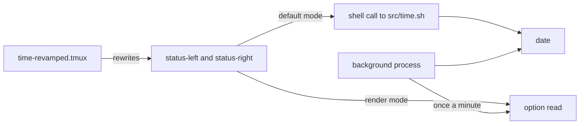

<div align="center">

# tmux-time-revamped

<strong>Local and world clocks for the tmux status bar, colored by time of day, with countdowns and a DST warning.</strong>

English | [日本語](README.ja.md) | [简体中文](README.zh-Hans.md) | [繁體中文（香港）](README.zh-HK.md)

[](https://github.com/tmux-revamped/tmux-time-revamped/actions/workflows/family.yml)
[](https://github.com/tmux-revamped/tmux-time-revamped/actions/workflows/tests.yml)
[](https://github.com/tmux-revamped/tmux-time-revamped/releases/latest)
[](https://scorecard.dev/viewer/?uri=github.com/tmux-revamped/tmux-time-revamped)
[](LICENSE)

<p align="center">
  <a href="#what-it-does">What it does</a> |
  <a href="#requirements">Requirements</a> |
  <a href="#installation">Installation</a> |
  <a href="#usage">Usage</a> |
  <a href="#configuration">Configuration</a> |
  <a href="#key-bindings">Key bindings</a> |
  <a href="#how-it-works">How it works</a>
</p>

</div>

**14** status placeholders. **4** actions, **1** of them bound by default. Every clock comes from the system `date` and timezone database, with no network call unless you turn on geoip.

---

## What it does

The plugin replaces placeholders in `status-left` and `status-right` with the local date and time, any number of world clocks, and a few developer and calendar fields. Each world clock is colored by the hour at that place, so you can see at a glance who is in their morning and who is asleep.

| Placeholder | Output |
|:------------|:-------|
| `#{time}` | local date and time, such as `2026-10-16 14:30` |
| `#{time_date}` | local date only |
| `#{time_clock}` | local time only |
| `#{time_zones}` | one entry per configured timezone, colored by time of day |
| `#{time_local}` | the local clock styled like a world clock, with a place label |
| `#{time_until}` | countdown to a target, such as `1d 4h` |
| `#{time_elapsed}` | time since the stopwatch mark, such as `12m` |
| `#{time_epoch}` | unix time in seconds |
| `#{time_iso}` | local time in ISO 8601, such as `2026-10-16T14:30:00-04:00` |
| `#{time_offset}` | local UTC offset, such as `UTC-04:00`, or `UTC` |
| `#{time_week}` | ISO 8601 week number |
| `#{time_doy}` | day of the year |
| `#{time_dst}` | `DST in 3d` when a clock change is within the horizon |
| `#{time_overlap}` | the working-hours window every configured zone shares, in local time |

## Requirements

| Tool | Version | Used for |
|:-----|:--------|:---------|
| tmux | 3.2 or later | the calendar popup uses `display-popup` |
| bash | 3.2 or later | macOS `/bin/bash` works |
| `date` and the timezone database | system | every clock, on GNU and BSD `date` |
| `cal` | system | the calendar popup |
| `curl` | optional | the geoip place label |
| `pbcopy`, `wl-copy` or `xclip` | optional | copying a timestamp to the system clipboard |

CI runs the test suite on Ubuntu LTS for x86_64 and arm64 with GNU and uutils coreutils, and on macOS for Apple Silicon and Intel with the system tools, GNU tools and uutils.

## Installation

With [TPM](https://github.com/tmux-plugins/tpm), add the plugin and a placeholder to `~/.tmux.conf`, then press `prefix + I`:

```tmux
set -g @plugin 'tmux-revamped/tmux-time-revamped'
set -g status-right '#{time}'
```

Without TPM, clone the repository and run the entry point after your `status-right` is set:

```bash
git clone https://github.com/tmux-revamped/tmux-time-revamped ~/.tmux/plugins/tmux-time-revamped
```

```tmux
run-shell ~/.tmux/plugins/tmux-time-revamped/time-revamped.tmux
```

## Usage

```tmux
set -g @time_revamped_timezones 'America/New_York, Europe/London, Asia/Tokyo'
set -g status-right '#{time} #{time_zones}'
```

With the local clock in New York, the right side of the status bar reads:

```text
2026-10-16 14:30 EDT 14:30 BST 19:30 JST 03:30
```

Each world clock carries its own color: morning, day, afternoon, evening, night, or the weekend color on Saturday and Sunday.

### World clock decorations

| Setting | Effect |
|:--------|:-------|
| `@time_revamped_compact '1'` | short city labels instead of zone abbreviations: `NY` for `America/New_York`, `Tok` for `Asia/Tokyo` |
| `@time_revamped_zone_labels 'NYC, LDN, TYO'` | your own labels, matched to the zones by position |
| `@time_revamped_relative_day '1'` | a `+1d` or `-1d` badge on a zone that is on another calendar day |
| `@time_revamped_work_hours '1'` | dims a zone outside `@time_revamped_work_start` to `@time_revamped_work_end` |
| `@time_revamped_primary '0'` | shows the zone at that zero-based index in bold |

`#{time_overlap}` intersects the working hours of every configured zone and prints the longest shared window in local time, such as `overlap 13:00-17:00`. With no shared hour it prints the label followed by `@time_revamped_overlap_none`, which reads `overlap no overlap` by default.

### The local place label

`#{time_local}` needs a place name. By default it takes the city from `TZ` or from the `/etc/localtime` link, offline. With `@time_revamped_local_source 'geoip'` it asks `@time_revamped_geoip_endpoint` for the city of your public IP instead. That request runs in the background every `@time_revamped_geoip_interval` minutes, times out after 3 seconds, keeps the last city when it fails, and sends your IP to the endpoint, so turn it on only when that is acceptable. A city is accepted only when it holds letters, digits, spaces, UTF-8 characters and `. , ' -`, at most 64 characters.

### Countdown, stopwatch and DST

`#{time_until}` counts down to `@time_revamped_countdown_target`, written as `YYYY-MM-DD` or `YYYY-MM-DD HH:MM`. Once the target passes it shows `@time_revamped_countdown_done`. `#{time_elapsed}` counts from the mark that the mark action sets. `#{time_dst}` checks the UTC offset of `@time_revamped_dst_zone`, or the local zone, once per day ahead for `@time_revamped_dst_horizon` days and reports the first change.

### Render mode

By default each placeholder becomes a `#()` call, which tmux reruns on every status redraw. Set `@time_revamped_render` to `options` and each placeholder becomes an option read such as `#{E:@time_revamped_out_local}`. One background process per server then renders every clock the status line uses, once a minute, one second after the minute changes, and writes them in a single tmux call, so the clocks change together.

```tmux
set -g @time_revamped_render 'options'
```

## Configuration

| Option | Default | Meaning |
|:-------|:--------|:--------|
| `@time_revamped_date_format` | `YMD` | `YMD`, `MD`, `DM`, `MDY`, `DMY` or `hide` |
| `@time_revamped_time_format` | `24H` | `24H`, `12H` or `hide`, for the local clock and every world clock |
| `@time_revamped_timezones` | empty | timezone names separated by commas or spaces |
| `@time_revamped_compact` | `0` | `1` for short city labels |
| `@time_revamped_zone_labels` | empty | comma-separated labels matched to the zones by position |
| `@time_revamped_zone_separator` | a space | text between world-clock entries |
| `@time_revamped_weekend_override` | `1` | `0` keeps the time-of-day color and icon on weekends |
| `@time_revamped_local_label` | empty | fixed label for `#{time_local}` |
| `@time_revamped_local_source` | `timezone` | `timezone` or `geoip` |
| `@time_revamped_geoip_endpoint` | `https://ipinfo.io/city` | URL returning a plain-text city or JSON with a `city` field |
| `@time_revamped_geoip_interval` | `30` | minutes between geoip requests |
| `@time_revamped_morning_color` | `#[fg=yellow]` | hours 05 to 12 |
| `@time_revamped_day_color` | `#[fg=green]` | hours 12 to 14 |
| `@time_revamped_afternoon_color` | `#[fg=cyan]` | hours 14 to 18 |
| `@time_revamped_evening_color` | `#[fg=magenta]` | hours 18 to 22 |
| `@time_revamped_night_color` | `#[fg=blue]` | hours 22 to 05 |
| `@time_revamped_weekend_color` | `#[fg=brightblack]` | Saturday and Sunday |
| `@time_revamped_{sunrise,morning,day,afternoon,sunset,evening,night,weekend}_icon` | empty | glyph for that period. Sunrise covers 05 to 08 and sunset 18 to 20 |
| `@time_revamped_icon_position` | `middle` | `middle` gives `NYC <icon> 18:00`, `before` gives `<icon> NYC 18:00` |
| `@time_revamped_reset` | `#[default]` | style written after each entry. `#[fg=default]` keeps a theme background |
| `@time_revamped_relative_day` | `0` | `1` adds the `+1d` or `-1d` badge |
| `@time_revamped_work_hours` | `0` | `1` dims zones outside working hours |
| `@time_revamped_work_start` | `9` | first working hour, inclusive |
| `@time_revamped_work_end` | `17` | last working hour, exclusive |
| `@time_revamped_dim_style` | `#[dim]` | style for a zone outside working hours. `none` turns it off |
| `@time_revamped_primary` | empty | zero-based index of the zone to highlight |
| `@time_revamped_primary_style` | `#[bold]` | style for the primary zone. `none` turns it off |
| `@time_revamped_countdown_target` | empty | target for `#{time_until}` |
| `@time_revamped_countdown_label` | empty | text before the countdown |
| `@time_revamped_countdown_done` | `now` | text once the target has passed |
| `@time_revamped_dst_zone` | empty | zone watched by `#{time_dst}`. Empty means local |
| `@time_revamped_dst_horizon` | `14` | days ahead to look for a clock change |
| `@time_revamped_dst_label` | `DST` | text before the day count |
| `@time_revamped_overlap_label` | `overlap` | text before the overlap window |
| `@time_revamped_overlap_none` | `no overlap` | text when no hour is shared |
| `@time_revamped_render` | empty | `options` turns on render mode |
| `@time_revamped_interval` | `minute` | render-mode cadence: `minute`, or a number of seconds. Anything else falls back to `status-interval`, then 5 seconds |
| `@time_revamped_menu_key` | `M-t` | prefix key for the actions menu. `off` binds nothing |
| `@time_revamped_calendar_key` | `off` | prefix key for the calendar popup |
| `@time_revamped_copy_key` | `off` | prefix key that copies the ISO timestamp |
| `@time_revamped_mark_key` | `off` | prefix key that sets the stopwatch mark |

The colors are the 16 ANSI names, so they follow your terminal theme. To pin exact shades, set the color options to hex values.

<details>
<summary><strong>Hex colors for six themes</strong></summary>

```tmux
# Catppuccin Mocha
set -g @time_revamped_morning_color '#[fg=#f9e2af]'
set -g @time_revamped_day_color '#[fg=#a6e3a1]'
set -g @time_revamped_afternoon_color '#[fg=#94e2d5]'
set -g @time_revamped_evening_color '#[fg=#cba6f7]'
set -g @time_revamped_night_color '#[fg=#89b4fa]'
set -g @time_revamped_weekend_color '#[fg=#a6adc8]'

# Dracula
set -g @time_revamped_morning_color '#[fg=#f1fa8c]'
set -g @time_revamped_day_color '#[fg=#50fa7b]'
set -g @time_revamped_afternoon_color '#[fg=#8be9fd]'
set -g @time_revamped_evening_color '#[fg=#ff79c6]'
set -g @time_revamped_night_color '#[fg=#bd93f9]'
set -g @time_revamped_weekend_color '#[fg=#6272a4]'

# Nord
set -g @time_revamped_morning_color '#[fg=#ebcb8b]'
set -g @time_revamped_day_color '#[fg=#a3be8c]'
set -g @time_revamped_afternoon_color '#[fg=#88c0d0]'
set -g @time_revamped_evening_color '#[fg=#b48ead]'
set -g @time_revamped_night_color '#[fg=#81a1c1]'
set -g @time_revamped_weekend_color '#[fg=#d8dee9]'

# Gruvbox Dark
set -g @time_revamped_morning_color '#[fg=#fabd2f]'
set -g @time_revamped_day_color '#[fg=#b8bb26]'
set -g @time_revamped_afternoon_color '#[fg=#8ec07c]'
set -g @time_revamped_evening_color '#[fg=#d3869b]'
set -g @time_revamped_night_color '#[fg=#83a598]'
set -g @time_revamped_weekend_color '#[fg=#a89984]'

# Tokyo Night
set -g @time_revamped_morning_color '#[fg=#e0af68]'
set -g @time_revamped_day_color '#[fg=#9ece6a]'
set -g @time_revamped_afternoon_color '#[fg=#7dcfff]'
set -g @time_revamped_evening_color '#[fg=#bb9af7]'
set -g @time_revamped_night_color '#[fg=#7aa2f7]'
set -g @time_revamped_weekend_color '#[fg=#565f89]'

# Solarized Dark
set -g @time_revamped_morning_color '#[fg=#b58900]'
set -g @time_revamped_day_color '#[fg=#859900]'
set -g @time_revamped_afternoon_color '#[fg=#2aa198]'
set -g @time_revamped_evening_color '#[fg=#d33682]'
set -g @time_revamped_night_color '#[fg=#268bd2]'
set -g @time_revamped_weekend_color '#[fg=#586e75]'
```

</details>

### Internal state

The plugin manages these options itself. Do not set them.

| Option | Holds |
|:-------|:------|
| `@time_revamped_mark_epoch` | unix time of the last stopwatch mark |
| `@time_revamped_published` | the placeholders the status line uses, recorded at load so render mode publishes only those |
| `@time_revamped_out_<name>` | each rendered value in render mode |
| `@time_revamped_ticker_pid` | the process that owns render mode. A reload hands ownership to a new process and the old one exits |
| `@time_revamped_option_names` | the options render mode reads in one tmux call per tick |
| `@time_revamped_geoip_city` | the last city from geoip, with `_ts` and `_lock` companions for its age and the running request |

## Key bindings

| Key | Option | Action |
|:----|:-------|:-------|
| `prefix + M-t` | `@time_revamped_menu_key` | open the actions menu |
| unbound | `@time_revamped_calendar_key` | calendar popup |
| unbound | `@time_revamped_copy_key` | copy the ISO timestamp |
| unbound | `@time_revamped_mark_key` | set the stopwatch mark |

The menu has six entries: `h` toggles 12 and 24 hour time, `c` opens the calendar, `i` and `e` copy the time as ISO 8601 or unix seconds to the tmux buffer and the system clipboard, `m` sets the stopwatch mark, and `d` runs a doctor that checks each configured timezone name against `/usr/share/zoneinfo`. Set `@time_revamped_menu_key` to `T` to get the key used before 2.0.0 back.

## How it works



At load, [`time-revamped.tmux`](time-revamped.tmux) replaces each placeholder in the status line with a call to [`src/time.sh`](src/time.sh), or with an option read in render mode, and binds the keys. A clock read is one `date` call, so the default `#()` mode returns at once. In render mode the entry point starts one background process, which claims `@time_revamped_ticker_pid`, renders the published clocks on each tick, and stops when another process claims the option or the server goes away.

The DST and overlap checks run `date` with `-d` on GNU and `-r` on BSD, detected once per process. Countdowns, the stopwatch, relative days and the overlap window are integer arithmetic in bash.

## Development

| Command | What it runs |
|:--------|:-------------|
| `make test` | the bats suite |
| `make lint` | shellcheck at warning level on every shell file |
| `make coverage` | kcov line coverage with a 95 percent floor, Linux only |
| [`family/bin/audit`](family/bin/audit) | this repository against the family contract |

## License

[MIT](LICENSE), copyright Gustavo Franco.

<!-- family:begin -->

## The tmux-revamped family

This plugin is one member of the tmux-revamped family. Every member carries the
same contract in [`FAMILY.md`](FAMILY.md), the same tooling under `family/`, and
the same shared library, all held byte-identical by a checksum manifest. They are
built to be installed together: no member claims a key or a tmux option that
another member claims.

A defect found in one member is hunted across all of them before the fix is
called done. That obligation is written into the contract rather than left to
memory, and `family/bin/sweep` is how it is discharged.

| Member | What it does |
|---|---|
| [`tmux-autoreload-revamped`](https://github.com/tmux-revamped/tmux-autoreload-revamped) | Edit your tmux config, save, and watch it reload itself, no key, no command |
| [`tmux-battery-revamped`](https://github.com/tmux-revamped/tmux-battery-revamped) | Battery status for your tmux status bar, without ever blocking the status render |
| [`tmux-bluetooth-revamped`](https://github.com/tmux-revamped/tmux-bluetooth-revamped) | Every connected Bluetooth device and its battery in your tmux status bar, without blocking the render |
| [`tmux-cpu-revamped`](https://github.com/tmux-revamped/tmux-cpu-revamped) | CPU load, temperature, and frequency in your tmux status bar, without ever blocking the render |
| [`tmux-disk-revamped`](https://github.com/tmux-revamped/tmux-disk-revamped) | Disk usage for your tmux status bar, without ever blocking the status render |
| [`tmux-extract-revamped`](https://github.com/tmux-revamped/tmux-extract-revamped) | Pick a URL, path, hash or any other token off the screen with fzf and type it at the cursor, in pure shell |
| [`tmux-fzf-revamped`](https://github.com/tmux-revamped/tmux-fzf-revamped) | Switch to, kill, rename or create tmux sessions, windows and panes from fzf pickers in a popup |
| [`tmux-git-revamped`](https://github.com/tmux-revamped/tmux-git-revamped) | Show the active pane's git branch, changes and provider counts in the tmux status bar without blocking it |
| [`tmux-gpu-revamped`](https://github.com/tmux-revamped/tmux-gpu-revamped) | GPU load, temperature, clock, power and memory in the tmux status bar, from NVIDIA, AMD, Intel and Apple GPUs |
| [`tmux-kube-revamped`](https://github.com/tmux-revamped/tmux-kube-revamped) | Current Kubernetes context and namespace in the tmux status bar, parsed from kubeconfig without kubectl |
| [`tmux-launcher-revamped`](https://github.com/tmux-revamped/tmux-launcher-revamped) | Launch any TUI app in a popup or a window, scoped to the current pane's directory, with one configurable bindi |
| [`tmux-logging-revamped`](https://github.com/tmux-revamped/tmux-logging-revamped) | Capture any pane to a file: live logging, full scrollback, or a one-shot screenshot |
| [`tmux-music-revamped`](https://github.com/tmux-revamped/tmux-music-revamped) | Now playing in your tmux status bar, without ever blocking the status render |
| [`tmux-network-revamped`](https://github.com/tmux-revamped/tmux-network-revamped) | Network throughput in your tmux status bar, without ever blocking the render |
| [`tmux-pain-control-revamped`](https://github.com/tmux-revamped/tmux-pain-control-revamped) | Pane and window management bindings for tmux, version aware, vim friendly, every prefix key can be disabled |
| [`tmux-persist-revamped`](https://github.com/tmux-revamped/tmux-persist-revamped) | Save every tmux session, window and pane, auto-save on a timer, and restore it all after a reboot |
| [`tmux-plugin-template`](https://github.com/tmux-revamped/tmux-plugin-template) | The starting point for a tmux-revamped plugin: shared library, bats harness, CI and family tooling |
| [`tmux-pomodoro-revamped`](https://github.com/tmux-revamped/tmux-pomodoro-revamped) | A Pomodoro timer in the tmux status bar that keeps all of its state in tmux options, with no temp files |
| [`tmux-ram-revamped`](https://github.com/tmux-revamped/tmux-ram-revamped) | RAM, swap and memory pressure in the tmux status bar, sampled in the background so the render never waits |
| [`tmux-reorder-revamped`](https://github.com/tmux-revamped/tmux-reorder-revamped) | Drag a window tab along the tmux status bar with the mouse to move that window |
| [`tmux-scroll-revamped`](https://github.com/tmux-revamped/tmux-scroll-revamped) | Send the mouse wheel to apps that scroll themselves and into tmux copy-mode everywhere else |
| [`tmux-sensible-revamped`](https://github.com/tmux-revamped/tmux-sensible-revamped) | Sensible tmux defaults, gated by tmux version and terminal, that leave the options you set alone |
| [`tmux-tiling-revamped`](https://github.com/tmux-revamped/tmux-tiling-revamped) | Tiling window management for tmux: eight layouts including BSP dwindle and spiral, with layout undo |
| [`tmux-time-revamped`](https://github.com/tmux-revamped/tmux-time-revamped) | **this plugin**, Local and world clocks for the tmux status bar, colored by time of day, with countdowns and a DST warning |
| [`tmux-weather-revamped`](https://github.com/tmux-revamped/tmux-weather-revamped) | Weather for the tmux status bar from wttr.in, fetched in the background so the status line never waits |

### Checking an installation

With every member on disk, one command reports any conflict between them:

```sh
family/bin/doctor --live
```

It reads each member and the running tmux server, and reports duplicate keys,
duplicate status placeholders, options outside the naming grammar, and any
member whose contract version has fallen behind.

<!-- family:end -->
