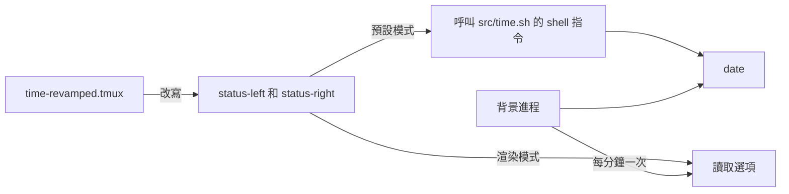

<div align="center">

# tmux-time-revamped

<strong>狀態列中的本地時鐘和世界時鐘，按一天中的時段著色，並提供倒數和夏令時間提示。</strong>

[English](README.md) | [日本語](README.ja.md) | [简体中文](README.zh-Hans.md) | 繁體中文（香港）

[](https://github.com/tmux-revamped/tmux-time-revamped/actions/workflows/family.yml)
[](https://github.com/tmux-revamped/tmux-time-revamped/actions/workflows/tests.yml)
[](https://github.com/tmux-revamped/tmux-time-revamped/releases/latest)
[](https://scorecard.dev/viewer/?uri=github.com/tmux-revamped/tmux-time-revamped)
[](LICENSE)

<p align="center">
  <a href="#功能">功能</a> |
  <a href="#系統要求">系統要求</a> |
  <a href="#安裝">安裝</a> |
  <a href="#用法">用法</a> |
  <a href="#設定">設定</a> |
  <a href="#快捷鍵">快捷鍵</a> |
  <a href="#運作原理">運作原理</a>
</p>

</div>

**14** 個狀態佔位符。**4** 個操作，其中 **1** 個預設綁定。所有時鐘都來自系統的 `date` 和時區資料庫，除非開啟 geoip，否則不會連接網絡。

---

## 功能

本插件把 `status-left` 和 `status-right` 中的佔位符取代為本地日期和時間、任何數量的世界時鐘，以及一些開發和日曆用的欄位。每個世界時鐘按當地的鐘點著色，一眼便看出誰在早上、誰在睡覺。

| 佔位符 | 輸出 |
|:------------|:-------|
| `#{time}` | 本地日期和時間，例如 `2026-10-16 14:30` |
| `#{time_date}` | 只有本地日期 |
| `#{time_clock}` | 只有本地時間 |
| `#{time_zones}` | 每個已設定時區一項，按時段著色 |
| `#{time_local}` | 與世界時鐘樣式一致的本地時鐘，附地點標籤 |
| `#{time_until}` | 到目標時間的倒數，例如 `1d 4h` |
| `#{time_elapsed}` | 自秒錶標記以來的時間，例如 `12m` |
| `#{time_epoch}` | Unix 時間，以秒為單位 |
| `#{time_iso}` | ISO 8601 格式的本地時間，例如 `2026-10-16T14:30:00-04:00` |
| `#{time_offset}` | 本地 UTC 偏移，例如 `UTC-04:00`，或 `UTC` |
| `#{time_week}` | ISO 8601 週數 |
| `#{time_doy}` | 一年中的第幾天 |
| `#{time_dst}` | 時鐘調整在範圍內時顯示 `DST in 3d` |
| `#{time_overlap}` | 所有已設定時區共有的工作時段，以本地時間顯示 |

## 系統要求

| 工具 | 版本 | 用途 |
|:-----|:--------|:---------|
| tmux | 3.2 或以上 | 日曆彈出視窗使用 `display-popup` |
| bash | 3.2 或以上 | 可使用 macOS 的 `/bin/bash` |
| `date` 和時區資料庫 | 系統內置 | 所有時鐘，支援 GNU 和 BSD 的 `date` |
| `cal` | 系統內置 | 日曆彈出視窗 |
| `curl` | 可選 | geoip 地點標籤 |
| `pbcopy`、`wl-copy` 或 `xclip` | 可選 | 把時間戳記複製到系統剪貼簿 |

CI 在 Ubuntu LTS 的 x86_64 和 arm64 上使用 GNU 和 uutils coreutils 執行測試，在 macOS 的 Apple Silicon 和 Intel 上使用系統工具、GNU 工具和 uutils 執行測試。

## 安裝

使用 [TPM](https://github.com/tmux-plugins/tpm) 時，把插件和一個佔位符加入 `~/.tmux.conf`，然後按 `prefix + I`：

```tmux
set -g @plugin 'tmux-revamped/tmux-time-revamped'
set -g status-right '#{time}'
```

不使用 TPM 時，複製儲存庫，並在設定 `status-right` 之後執行入口腳本：

```bash
git clone https://github.com/tmux-revamped/tmux-time-revamped ~/.tmux/plugins/tmux-time-revamped
```

```tmux
run-shell ~/.tmux/plugins/tmux-time-revamped/time-revamped.tmux
```

## 用法

```tmux
set -g @time_revamped_timezones 'America/New_York, Europe/London, Asia/Tokyo'
set -g status-right '#{time} #{time_zones}'
```

本地時鐘在紐約時，狀態列右方顯示為：

```text
2026-10-16 14:30 EDT 14:30 BST 19:30 JST 03:30
```

每個世界時鐘都有自己的顏色：早上、中午、下午、傍晚、夜間，或星期六和星期日的週末顏色。

### 世界時鐘裝飾

| 設定 | 效果 |
|:--------|:-------|
| `@time_revamped_compact '1'` | 以簡短城市名代替時區縮寫：`America/New_York` 為 `NY`，`Asia/Tokyo` 為 `Tok` |
| `@time_revamped_zone_labels 'NYC, LDN, TYO'` | 自訂標籤，按次序對應各時區 |
| `@time_revamped_relative_day '1'` | 在處於另一個日期的時區旁顯示 `+1d` 或 `-1d` 標記 |
| `@time_revamped_work_hours '1'` | 淡化處於 `@time_revamped_work_start` 至 `@time_revamped_work_end` 以外的時區 |
| `@time_revamped_primary '0'` | 以粗體顯示該由零開始編號的時區 |

`#{time_overlap}` 求出所有已設定時區工作時間的交集，並以本地時間顯示最長的共同時段，例如 `overlap 13:00-17:00`。沒有共同時段時，顯示標籤加上 `@time_revamped_overlap_none`，預設為 `overlap no overlap`。

### 本地地點標籤

`#{time_local}` 需要一個地點名稱。預設以離線方式從 `TZ` 或 `/etc/localtime` 連結取得城市名。設定 `@time_revamped_local_source 'geoip'` 後，會改為向 `@time_revamped_geoip_endpoint` 查詢你的公共 IP 所在城市。該請求每隔 `@time_revamped_geoip_interval` 分鐘在背景執行，3 秒逾時，失敗時保留上一個城市，並會把你的 IP 傳送給該端點，所以請只在可以接受時開啟。只接受由字母、數字、空格、UTF-8 字符和 `. , ' -` 組成而不超過 64 個字符的城市名。

### 倒數、秒錶與夏令時間

`#{time_until}` 倒數至 `@time_revamped_countdown_target`，格式為 `YYYY-MM-DD` 或 `YYYY-MM-DD HH:MM`。目標過去後顯示 `@time_revamped_countdown_done`。`#{time_elapsed}` 由標記操作設定的標記開始計時。`#{time_dst}` 逐日檢查 `@time_revamped_dst_zone` 或本地時區在未來 `@time_revamped_dst_horizon` 天內的 UTC 偏移，並報告第一次變化。

### 渲染模式

預設情況下每個佔位符都變成一個 `#()` 呼叫，tmux 每次重繪狀態列都會重新執行它。把 `@time_revamped_render` 設為 `options` 後，每個佔位符變成對選項的讀取，例如 `#{E:@time_revamped_out_local}`。每部伺服器上的一個背景進程會在每分鐘轉換後一秒繪製狀態列用到的所有時鐘，每分鐘一次，並以一次 tmux 呼叫寫入，因此所有時鐘同時轉變。

```tmux
set -g @time_revamped_render 'options'
```

## 設定

| 選項 | 預設值 | 意思 |
|:-------|:--------|:--------|
| `@time_revamped_date_format` | `YMD` | `YMD`、`MD`、`DM`、`MDY`、`DMY` 或 `hide` |
| `@time_revamped_time_format` | `24H` | `24H`、`12H` 或 `hide`，適用於本地時鐘和所有世界時鐘 |
| `@time_revamped_timezones` | 空 | 以逗號或空格分隔的時區名稱 |
| `@time_revamped_compact` | `0` | 設為 `1` 使用簡短城市名 |
| `@time_revamped_zone_labels` | 空 | 以逗號分隔、按次序對應各時區的標籤 |
| `@time_revamped_zone_separator` | 一個空格 | 世界時鐘各項之間的文字 |
| `@time_revamped_weekend_override` | `1` | 設為 `0` 時週末也保留時段顏色和圖示 |
| `@time_revamped_local_label` | 空 | `#{time_local}` 的固定標籤 |
| `@time_revamped_local_source` | `timezone` | `timezone` 或 `geoip` |
| `@time_revamped_geoip_endpoint` | `https://ipinfo.io/city` | 傳回純文字城市名或附 `city` 欄位的 JSON 的 URL |
| `@time_revamped_geoip_interval` | `30` | geoip 請求的間隔，以分鐘計 |
| `@time_revamped_morning_color` | `#[fg=yellow]` | 05 時至 12 時 |
| `@time_revamped_day_color` | `#[fg=green]` | 12 時至 14 時 |
| `@time_revamped_afternoon_color` | `#[fg=cyan]` | 14 時至 18 時 |
| `@time_revamped_evening_color` | `#[fg=magenta]` | 18 時至 22 時 |
| `@time_revamped_night_color` | `#[fg=blue]` | 22 時至 05 時 |
| `@time_revamped_weekend_color` | `#[fg=brightblack]` | 星期六和星期日 |
| `@time_revamped_{sunrise,morning,day,afternoon,sunset,evening,night,weekend}_icon` | 空 | 該時段的圖示。sunrise 為 05 時至 08 時，sunset 為 18 時至 20 時 |
| `@time_revamped_icon_position` | `middle` | `middle` 顯示為 `NYC <icon> 18:00`，`before` 顯示為 `<icon> NYC 18:00` |
| `@time_revamped_reset` | `#[default]` | 每項之後寫入的樣式。`#[fg=default]` 可保留主題背景 |
| `@time_revamped_relative_day` | `0` | 設為 `1` 時加上 `+1d` 或 `-1d` 標記 |
| `@time_revamped_work_hours` | `0` | 設為 `1` 時淡化工作時間以外的時區 |
| `@time_revamped_work_start` | `9` | 工作開始的鐘點，包括在內 |
| `@time_revamped_work_end` | `17` | 工作結束的鐘點，不包括在內 |
| `@time_revamped_dim_style` | `#[dim]` | 工作時間以外的時區樣式。`none` 表示關閉 |
| `@time_revamped_primary` | 空 | 要突顯的時區，由零開始編號 |
| `@time_revamped_primary_style` | `#[bold]` | 主時區的樣式。`none` 表示關閉 |
| `@time_revamped_countdown_target` | 空 | `#{time_until}` 的目標時間 |
| `@time_revamped_countdown_label` | 空 | 倒數前的文字 |
| `@time_revamped_countdown_done` | `now` | 目標過去後顯示的文字 |
| `@time_revamped_dst_zone` | 空 | `#{time_dst}` 監察的時區。空表示本地時區 |
| `@time_revamped_dst_horizon` | `14` | 向前尋找時鐘調整的天數 |
| `@time_revamped_dst_label` | `DST` | 天數前的文字 |
| `@time_revamped_overlap_label` | `overlap` | 重疊時段前的文字 |
| `@time_revamped_overlap_none` | `no overlap` | 沒有共同時段時的文字 |
| `@time_revamped_render` | 空 | 設為 `options` 開啟渲染模式 |
| `@time_revamped_interval` | `minute` | 渲染模式的節奏：`minute` 或秒數。其他值依次退回 `status-interval`，再退回 5 秒 |
| `@time_revamped_menu_key` | `M-t` | 開啟操作選單的前綴鍵。`off` 表示不綁定 |
| `@time_revamped_calendar_key` | `off` | 日曆彈出視窗的前綴鍵 |
| `@time_revamped_copy_key` | `off` | 複製 ISO 時間戳記的前綴鍵 |
| `@time_revamped_mark_key` | `off` | 設定秒錶標記的前綴鍵 |

顏色使用 16 種 ANSI 名稱，因此會跟隨終端機主題。如要固定確切色調，把顏色選項設為十六進制值。

<details>
<summary><strong>六個主題的十六進制顏色</strong></summary>

```tmux
# Catppuccin Mocha
set -g @time_revamped_morning_color '#[fg=#f9e2af]'
set -g @time_revamped_day_color '#[fg=#a6e3a1]'
set -g @time_revamped_afternoon_color '#[fg=#94e2d5]'
set -g @time_revamped_evening_color '#[fg=#cba6f7]'
set -g @time_revamped_night_color '#[fg=#89b4fa]'
set -g @time_revamped_weekend_color '#[fg=#a6adc8]'

# Dracula
set -g @time_revamped_morning_color '#[fg=#f1fa8c]'
set -g @time_revamped_day_color '#[fg=#50fa7b]'
set -g @time_revamped_afternoon_color '#[fg=#8be9fd]'
set -g @time_revamped_evening_color '#[fg=#ff79c6]'
set -g @time_revamped_night_color '#[fg=#bd93f9]'
set -g @time_revamped_weekend_color '#[fg=#6272a4]'

# Nord
set -g @time_revamped_morning_color '#[fg=#ebcb8b]'
set -g @time_revamped_day_color '#[fg=#a3be8c]'
set -g @time_revamped_afternoon_color '#[fg=#88c0d0]'
set -g @time_revamped_evening_color '#[fg=#b48ead]'
set -g @time_revamped_night_color '#[fg=#81a1c1]'
set -g @time_revamped_weekend_color '#[fg=#d8dee9]'

# Gruvbox Dark
set -g @time_revamped_morning_color '#[fg=#fabd2f]'
set -g @time_revamped_day_color '#[fg=#b8bb26]'
set -g @time_revamped_afternoon_color '#[fg=#8ec07c]'
set -g @time_revamped_evening_color '#[fg=#d3869b]'
set -g @time_revamped_night_color '#[fg=#83a598]'
set -g @time_revamped_weekend_color '#[fg=#a89984]'

# Tokyo Night
set -g @time_revamped_morning_color '#[fg=#e0af68]'
set -g @time_revamped_day_color '#[fg=#9ece6a]'
set -g @time_revamped_afternoon_color '#[fg=#7dcfff]'
set -g @time_revamped_evening_color '#[fg=#bb9af7]'
set -g @time_revamped_night_color '#[fg=#7aa2f7]'
set -g @time_revamped_weekend_color '#[fg=#565f89]'

# Solarized Dark
set -g @time_revamped_morning_color '#[fg=#b58900]'
set -g @time_revamped_day_color '#[fg=#859900]'
set -g @time_revamped_afternoon_color '#[fg=#2aa198]'
set -g @time_revamped_evening_color '#[fg=#d33682]'
set -g @time_revamped_night_color '#[fg=#268bd2]'
set -g @time_revamped_weekend_color '#[fg=#586e75]'
```

</details>

### 內部狀態

這些選項由插件自行管理，請勿設定。

| 選項 | 保存內容 |
|:-------|:------|
| `@time_revamped_mark_epoch` | 最後一次秒錶標記的 Unix 時間 |
| `@time_revamped_published` | 狀態列用到的佔位符，在載入時記錄，令渲染模式只發佈這些 |
| `@time_revamped_out_<name>` | 渲染模式下繪製出的每個值 |
| `@time_revamped_ticker_pid` | 負責渲染模式的進程。重新載入會把擁有權交給新進程，舊進程隨即結束 |
| `@time_revamped_option_names` | 渲染模式每次執行時以一次 tmux 呼叫讀取的選項 |
| `@time_revamped_geoip_city` | geoip 取得的最後一個城市，並附有表示其時效和進行中請求的 `_ts` 與 `_lock` |

## 快捷鍵

| 按鍵 | 選項 | 動作 |
|:----|:-------|:-------|
| `prefix + M-t` | `@time_revamped_menu_key` | 開啟操作選單 |
| 不綁定 | `@time_revamped_calendar_key` | 日曆彈出視窗 |
| 不綁定 | `@time_revamped_copy_key` | 複製 ISO 時間戳記 |
| 不綁定 | `@time_revamped_mark_key` | 設定秒錶標記 |

選單有六項：`h` 切換 12 小時和 24 小時制，`c` 開啟日曆，`i` 和 `e` 把時間以 ISO 8601 或 Unix 秒數複製到 tmux 緩衝區和系統剪貼簿，`m` 設定秒錶標記，`d` 執行診斷，把每個已設定的時區名稱與 `/usr/share/zoneinfo` 核對。把 `@time_revamped_menu_key` 設為 `T` 可還原 2.0.0 之前使用的按鍵。

## 運作原理



載入時，[`time-revamped.tmux`](time-revamped.tmux) 把狀態列中的每個佔位符取代為對 [`src/time.sh`](src/time.sh) 的呼叫，或在渲染模式下取代為對選項的讀取，並綁定按鍵。讀取時鐘只需一次 `date` 呼叫，因此預設的 `#()` 模式會即時返回。在渲染模式下，入口腳本啟動一個背景進程，它佔用 `@time_revamped_ticker_pid`，每次執行時繪製要發佈的時鐘，並在另一個進程佔用該選項或伺服器消失時停止。

夏令時間和重疊時段的檢查在 GNU 上用 `-d`、在 BSD 上用 `-r` 執行 `date`，每個進程只判斷一次。倒數、秒錶、相對日期和重疊時段都是 bash 的整數運算。

## 開發

| 指令 | 執行內容 |
|:--------|:-------------|
| `make test` | bats 測試套件 |
| `make lint` | 對所有 shell 檔案執行 warning 級別的 shellcheck |
| `make coverage` | kcov 行覆蓋率，下限 95%，只限 Linux |
| [`family/bin/audit`](family/bin/audit) | 按系列約定檢查本儲存庫 |

## 授權

[MIT](LICENSE)，copyright Gustavo Franco。

<!-- family:begin -->

## tmux-revamped 插件家族

本插件是 tmux-revamped 插件家族的成員。每個成員都帶有 [`FAMILY.md`](FAMILY.md) 中的同一份約定、`family/` 下的同一套工具和同一個共用程式庫，並由校驗和清單確保逐位元組一致。這些成員可以一併安裝：任何成員都不會佔用其他成員使用的按鍵或 tmux 選項。

在一個成員中發現的缺陷，要在全部成員中排查後才算修正完成。這項責任寫在約定之中，而不是依靠記憶，`family/bin/sweep` 負責執行。

| 成員 | 功能 |
|---|---|
| [`tmux-autoreload-revamped`](https://github.com/tmux-revamped/tmux-autoreload-revamped) | 編輯並儲存 tmux 設定後，它會自動重新載入，毋須按鍵，也毋須指令 |
| [`tmux-battery-revamped`](https://github.com/tmux-revamped/tmux-battery-revamped) | 在 tmux 狀態列顯示電池狀態，從不阻塞狀態列繪製 |
| [`tmux-bluetooth-revamped`](https://github.com/tmux-revamped/tmux-bluetooth-revamped) | 在 tmux 狀態列顯示每部已連接的藍牙裝置及其電量，不阻塞繪製 |
| [`tmux-cpu-revamped`](https://github.com/tmux-revamped/tmux-cpu-revamped) | 在 tmux 狀態列顯示 CPU 負載、溫度及頻率，從不阻塞繪製 |
| [`tmux-disk-revamped`](https://github.com/tmux-revamped/tmux-disk-revamped) | 在 tmux 狀態列顯示磁碟用量，從不阻塞狀態列繪製 |
| [`tmux-extract-revamped`](https://github.com/tmux-revamped/tmux-extract-revamped) | 用 fzf 從畫面上揀選 URL、路徑、雜湊值或任何其他字詞，並輸入到游標位置，全部以純 shell 實現 |
| [`tmux-fzf-revamped`](https://github.com/tmux-revamped/tmux-fzf-revamped) | 在彈出視窗的 fzf 選擇器中切換、關閉、重新命名或建立 tmux 工作階段、視窗和窗格 |
| [`tmux-git-revamped`](https://github.com/tmux-revamped/tmux-git-revamped) | 在 tmux 狀態列顯示當前窗格的 git 分支、改動和託管平台數目，而不會阻塞顯示 |
| [`tmux-gpu-revamped`](https://github.com/tmux-revamped/tmux-gpu-revamped) | 在 tmux 狀態列顯示 NVIDIA、AMD、Intel 及 Apple GPU 的負載、溫度、時脈、功耗及記憶體 |
| [`tmux-kube-revamped`](https://github.com/tmux-revamped/tmux-kube-revamped) | 在 tmux 狀態列顯示目前的 Kubernetes 上下文及命名空間，毋須 kubectl，直接解析 kubeconfig |
| [`tmux-launcher-revamped`](https://github.com/tmux-revamped/tmux-launcher-revamped) | 在彈出視窗或新視窗中啟動任何 TUI 應用程式，從目前窗格的目錄開始，每個應用程式可設定一個按鍵 |
| [`tmux-logging-revamped`](https://github.com/tmux-revamped/tmux-logging-revamped) | 將任何窗格儲存到檔案：即時記錄、完整捲動緩衝區或一次性截圖 |
| [`tmux-music-revamped`](https://github.com/tmux-revamped/tmux-music-revamped) | 在 tmux 狀態列顯示正在播放的歌曲，從不阻塞狀態列的繪製 |
| [`tmux-network-revamped`](https://github.com/tmux-revamped/tmux-network-revamped) | 在 tmux 狀態列顯示網絡傳輸量，從不阻塞繪製 |
| [`tmux-pain-control-revamped`](https://github.com/tmux-revamped/tmux-pain-control-revamped) | tmux 的窗格和視窗管理按鍵，配合 tmux 版本，與 vim 相容，每個 prefix 按鍵都可停用 |
| [`tmux-persist-revamped`](https://github.com/tmux-revamped/tmux-persist-revamped) | 儲存 tmux 的所有工作階段、視窗及窗格，按計時器自動儲存，並在重新開機後全部還原 |
| [`tmux-plugin-template`](https://github.com/tmux-revamped/tmux-plugin-template) | tmux-revamped 插件的起點：共用程式庫、bats 測試框架、CI 和系列工具 |
| [`tmux-pomodoro-revamped`](https://github.com/tmux-revamped/tmux-pomodoro-revamped) | tmux 狀態列中的番茄鐘計時器，所有狀態都儲存在 tmux 選項中，不使用暫存檔 |
| [`tmux-ram-revamped`](https://github.com/tmux-revamped/tmux-ram-revamped) | 在 tmux 狀態列顯示記憶體、交換空間及記憶體壓力，在背景取樣，繪製從不等待 |
| [`tmux-reorder-revamped`](https://github.com/tmux-revamped/tmux-reorder-revamped) | 用滑鼠在 tmux 狀態列上拖動視窗標籤來移動該視窗 |
| [`tmux-scroll-revamped`](https://github.com/tmux-revamped/tmux-scroll-revamped) | 將滑鼠滾輪交給能自行捲動的應用程式，其他情況下進入 tmux 複製模式 |
| [`tmux-sensible-revamped`](https://github.com/tmux-revamped/tmux-sensible-revamped) | 按 tmux 版本和終端機區分的合理預設設定，不會改動你自己設定的選項 |
| [`tmux-tiling-revamped`](https://github.com/tmux-revamped/tmux-tiling-revamped) | tmux 的平鋪視窗管理：八種版面，包括 BSP dwindle 和 spiral，並支援復原版面 |
| [`tmux-time-revamped`](https://github.com/tmux-revamped/tmux-time-revamped) | **本插件**，狀態列中的本地時鐘和世界時鐘，按一天中的時段著色，並提供倒數和夏令時間提示 |
| [`tmux-weather-revamped`](https://github.com/tmux-revamped/tmux-weather-revamped) | 在背景從 wttr.in 取得天氣並顯示在狀態列，狀態列毋須等待 |

### 檢查安裝

所有成員都在磁碟上時，一個指令即可報告它們之間的任何衝突：

```sh
family/bin/doctor --live
```

它讀取每個成員和正在運行的 tmux 伺服器，報告重複的按鍵、重複的狀態佔位符、不符合命名規則的選項，以及約定版本落後的成員。

<!-- family:end -->
