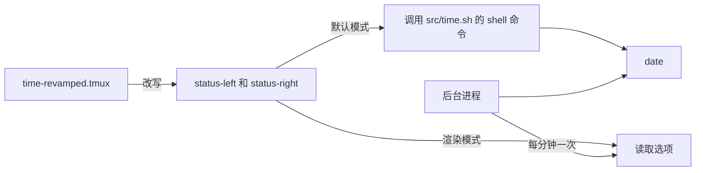

<div align="center">

# tmux-time-revamped

<strong>状态栏中的本地时钟和世界时钟，按一天中的时段着色，并提供倒计时和夏令时提醒。</strong>

[English](README.md) | [日本語](README.ja.md) | 简体中文 | [繁體中文（香港）](README.zh-HK.md)

[](https://github.com/tmux-revamped/tmux-time-revamped/actions/workflows/family.yml)
[](https://github.com/tmux-revamped/tmux-time-revamped/actions/workflows/tests.yml)
[](https://github.com/tmux-revamped/tmux-time-revamped/releases/latest)
[](https://scorecard.dev/viewer/?uri=github.com/tmux-revamped/tmux-time-revamped)
[](LICENSE)

<p align="center">
  <a href="#功能">功能</a> |
  <a href="#环境要求">环境要求</a> |
  <a href="#安装">安装</a> |
  <a href="#用法">用法</a> |
  <a href="#配置">配置</a> |
  <a href="#快捷键">快捷键</a> |
  <a href="#工作原理">工作原理</a>
</p>

</div>

**14** 个状态占位符。**4** 个操作，其中 **1** 个默认绑定。所有时钟都来自系统的 `date` 和时区数据库，除非开启 geoip，否则不访问网络。

---

## 功能

本插件把 `status-left` 和 `status-right` 中的占位符替换为本地日期和时间、任意数量的世界时钟，以及一些面向开发和日历的字段。每个世界时钟按当地的钟点着色，一眼就能看出谁在上午、谁在睡觉。

| 占位符 | 输出 |
|:------------|:-------|
| `#{time}` | 本地日期和时间，例如 `2026-10-16 14:30` |
| `#{time_date}` | 仅本地日期 |
| `#{time_clock}` | 仅本地时间 |
| `#{time_zones}` | 每个已配置时区一项，按时段着色 |
| `#{time_local}` | 与世界时钟样式一致的本地时钟，带地点标签 |
| `#{time_until}` | 到目标时间的倒计时，例如 `1d 4h` |
| `#{time_elapsed}` | 自秒表标记以来的时间，例如 `12m` |
| `#{time_epoch}` | Unix 时间，单位为秒 |
| `#{time_iso}` | ISO 8601 格式的本地时间，例如 `2026-10-16T14:30:00-04:00` |
| `#{time_offset}` | 本地 UTC 偏移，例如 `UTC-04:00`，或 `UTC` |
| `#{time_week}` | ISO 8601 周数 |
| `#{time_doy}` | 一年中的第几天 |
| `#{time_dst}` | 时钟调整在范围内时显示 `DST in 3d` |
| `#{time_overlap}` | 所有已配置时区共有的工作时段，以本地时间显示 |

## 环境要求

| 工具 | 版本 | 用途 |
|:-----|:--------|:---------|
| tmux | 3.2 或更高 | 日历弹出窗口使用 `display-popup` |
| bash | 3.2 或更高 | 可用 macOS 的 `/bin/bash` |
| `date` 和时区数据库 | 系统自带 | 所有时钟，支持 GNU 和 BSD 的 `date` |
| `cal` | 系统自带 | 日历弹出窗口 |
| `curl` | 可选 | geoip 地点标签 |
| `pbcopy`、`wl-copy` 或 `xclip` | 可选 | 把时间戳复制到系统剪贴板 |

CI 在 Ubuntu LTS 的 x86_64 和 arm64 上使用 GNU 和 uutils coreutils 运行测试，在 macOS 的 Apple Silicon 和 Intel 上使用系统工具、GNU 工具和 uutils 运行测试。

## 安装

使用 [TPM](https://github.com/tmux-plugins/tpm) 时，把插件和一个占位符加入 `~/.tmux.conf`，然后按 `prefix + I`：

```tmux
set -g @plugin 'tmux-revamped/tmux-time-revamped'
set -g status-right '#{time}'
```

不使用 TPM 时，克隆仓库，并在设置 `status-right` 之后运行入口脚本：

```bash
git clone https://github.com/tmux-revamped/tmux-time-revamped ~/.tmux/plugins/tmux-time-revamped
```

```tmux
run-shell ~/.tmux/plugins/tmux-time-revamped/time-revamped.tmux
```

## 用法

```tmux
set -g @time_revamped_timezones 'America/New_York, Europe/London, Asia/Tokyo'
set -g status-right '#{time} #{time_zones}'
```

本地时钟在纽约时，状态栏右侧显示为：

```text
2026-10-16 14:30 EDT 14:30 BST 19:30 JST 03:30
```

每个世界时钟都有自己的颜色：上午、中午、下午、傍晚、夜间，或周六和周日的周末颜色。

### 世界时钟装饰

| 设置 | 效果 |
|:--------|:-------|
| `@time_revamped_compact '1'` | 用简短城市名代替时区缩写：`America/New_York` 为 `NY`，`Asia/Tokyo` 为 `Tok` |
| `@time_revamped_zone_labels 'NYC, LDN, TYO'` | 自定义标签，按顺序对应各时区 |
| `@time_revamped_relative_day '1'` | 在处于另一个日期的时区旁显示 `+1d` 或 `-1d` 标记 |
| `@time_revamped_work_hours '1'` | 淡化处于 `@time_revamped_work_start` 到 `@time_revamped_work_end` 之外的时区 |
| `@time_revamped_primary '0'` | 以粗体显示该从零开始编号的时区 |

`#{time_overlap}` 求出所有已配置时区工作时间的交集，并以本地时间显示最长的共同时段，例如 `overlap 13:00-17:00`。没有共同时段时，显示标签加上 `@time_revamped_overlap_none`，默认为 `overlap no overlap`。

### 本地地点标签

`#{time_local}` 需要一个地点名称。默认离线地从 `TZ` 或 `/etc/localtime` 链接中取城市名。设置 `@time_revamped_local_source 'geoip'` 后，会改为向 `@time_revamped_geoip_endpoint` 查询你的公网 IP 所在城市。该请求每隔 `@time_revamped_geoip_interval` 分钟在后台运行，3 秒超时，失败时保留上一个城市，并会把你的 IP 发给该端点，因此请仅在可以接受时开启。只接受由字母、数字、空格、UTF-8 字符和 `. , ' -` 组成且不超过 64 个字符的城市名。

### 倒计时、秒表与夏令时

`#{time_until}` 倒数到 `@time_revamped_countdown_target`，格式为 `YYYY-MM-DD` 或 `YYYY-MM-DD HH:MM`。目标过去后显示 `@time_revamped_countdown_done`。`#{time_elapsed}` 从标记操作设置的标记开始计时。`#{time_dst}` 逐日检查 `@time_revamped_dst_zone` 或本地时区在未来 `@time_revamped_dst_horizon` 天内的 UTC 偏移，并报告第一次变化。

### 渲染模式

默认情况下每个占位符都变成一个 `#()` 调用，tmux 每次重绘状态栏都会重新运行它。把 `@time_revamped_render` 设为 `options` 后，每个占位符变成对选项的读取，例如 `#{E:@time_revamped_out_local}`。每个服务器上的一个后台进程会在每分钟切换后一秒渲染状态栏用到的全部时钟，每分钟一次，并在一次 tmux 调用中写入，因此所有时钟同时变化。

```tmux
set -g @time_revamped_render 'options'
```

## 配置

| 选项 | 默认值 | 含义 |
|:-------|:--------|:--------|
| `@time_revamped_date_format` | `YMD` | `YMD`、`MD`、`DM`、`MDY`、`DMY` 或 `hide` |
| `@time_revamped_time_format` | `24H` | `24H`、`12H` 或 `hide`，作用于本地时钟和所有世界时钟 |
| `@time_revamped_timezones` | 空 | 以逗号或空格分隔的时区名称 |
| `@time_revamped_compact` | `0` | 设为 `1` 使用简短城市名 |
| `@time_revamped_zone_labels` | 空 | 以逗号分隔、按顺序对应各时区的标签 |
| `@time_revamped_zone_separator` | 一个空格 | 世界时钟各项之间的文本 |
| `@time_revamped_weekend_override` | `1` | 设为 `0` 时周末也保留时段颜色和图标 |
| `@time_revamped_local_label` | 空 | `#{time_local}` 的固定标签 |
| `@time_revamped_local_source` | `timezone` | `timezone` 或 `geoip` |
| `@time_revamped_geoip_endpoint` | `https://ipinfo.io/city` | 返回纯文本城市名或带 `city` 字段的 JSON 的 URL |
| `@time_revamped_geoip_interval` | `30` | geoip 请求间隔，单位为分钟 |
| `@time_revamped_morning_color` | `#[fg=yellow]` | 05 点到 12 点 |
| `@time_revamped_day_color` | `#[fg=green]` | 12 点到 14 点 |
| `@time_revamped_afternoon_color` | `#[fg=cyan]` | 14 点到 18 点 |
| `@time_revamped_evening_color` | `#[fg=magenta]` | 18 点到 22 点 |
| `@time_revamped_night_color` | `#[fg=blue]` | 22 点到 05 点 |
| `@time_revamped_weekend_color` | `#[fg=brightblack]` | 周六和周日 |
| `@time_revamped_{sunrise,morning,day,afternoon,sunset,evening,night,weekend}_icon` | 空 | 该时段的图标。sunrise 为 05 点到 08 点，sunset 为 18 点到 20 点 |
| `@time_revamped_icon_position` | `middle` | `middle` 显示为 `NYC <icon> 18:00`，`before` 显示为 `<icon> NYC 18:00` |
| `@time_revamped_reset` | `#[default]` | 每项之后写入的样式。`#[fg=default]` 可保留主题背景 |
| `@time_revamped_relative_day` | `0` | 设为 `1` 时添加 `+1d` 或 `-1d` 标记 |
| `@time_revamped_work_hours` | `0` | 设为 `1` 时淡化工作时间之外的时区 |
| `@time_revamped_work_start` | `9` | 工作开始的钟点，包含在内 |
| `@time_revamped_work_end` | `17` | 工作结束的钟点，不包含在内 |
| `@time_revamped_dim_style` | `#[dim]` | 工作时间之外的时区样式。`none` 表示关闭 |
| `@time_revamped_primary` | 空 | 要突出显示的时区，从零开始编号 |
| `@time_revamped_primary_style` | `#[bold]` | 主时区的样式。`none` 表示关闭 |
| `@time_revamped_countdown_target` | 空 | `#{time_until}` 的目标时间 |
| `@time_revamped_countdown_label` | 空 | 倒计时前的文本 |
| `@time_revamped_countdown_done` | `now` | 目标过去后显示的文本 |
| `@time_revamped_dst_zone` | 空 | `#{time_dst}` 监视的时区。空表示本地时区 |
| `@time_revamped_dst_horizon` | `14` | 向前查找时钟调整的天数 |
| `@time_revamped_dst_label` | `DST` | 天数前的文本 |
| `@time_revamped_overlap_label` | `overlap` | 重叠时段前的文本 |
| `@time_revamped_overlap_none` | `no overlap` | 没有共同时段时的文本 |
| `@time_revamped_render` | 空 | 设为 `options` 开启渲染模式 |
| `@time_revamped_interval` | `minute` | 渲染模式的节奏：`minute` 或秒数。其他值依次回退到 `status-interval`，再到 5 秒 |
| `@time_revamped_menu_key` | `M-t` | 打开操作菜单的前缀键。`off` 表示不绑定 |
| `@time_revamped_calendar_key` | `off` | 日历弹出窗口的前缀键 |
| `@time_revamped_copy_key` | `off` | 复制 ISO 时间戳的前缀键 |
| `@time_revamped_mark_key` | `off` | 设置秒表标记的前缀键 |

颜色使用 16 种 ANSI 名称，因此会跟随终端主题。若要固定确切色调，把颜色选项设为十六进制值。

<details>
<summary><strong>六个主题的十六进制颜色</strong></summary>

```tmux
# Catppuccin Mocha
set -g @time_revamped_morning_color '#[fg=#f9e2af]'
set -g @time_revamped_day_color '#[fg=#a6e3a1]'
set -g @time_revamped_afternoon_color '#[fg=#94e2d5]'
set -g @time_revamped_evening_color '#[fg=#cba6f7]'
set -g @time_revamped_night_color '#[fg=#89b4fa]'
set -g @time_revamped_weekend_color '#[fg=#a6adc8]'

# Dracula
set -g @time_revamped_morning_color '#[fg=#f1fa8c]'
set -g @time_revamped_day_color '#[fg=#50fa7b]'
set -g @time_revamped_afternoon_color '#[fg=#8be9fd]'
set -g @time_revamped_evening_color '#[fg=#ff79c6]'
set -g @time_revamped_night_color '#[fg=#bd93f9]'
set -g @time_revamped_weekend_color '#[fg=#6272a4]'

# Nord
set -g @time_revamped_morning_color '#[fg=#ebcb8b]'
set -g @time_revamped_day_color '#[fg=#a3be8c]'
set -g @time_revamped_afternoon_color '#[fg=#88c0d0]'
set -g @time_revamped_evening_color '#[fg=#b48ead]'
set -g @time_revamped_night_color '#[fg=#81a1c1]'
set -g @time_revamped_weekend_color '#[fg=#d8dee9]'

# Gruvbox Dark
set -g @time_revamped_morning_color '#[fg=#fabd2f]'
set -g @time_revamped_day_color '#[fg=#b8bb26]'
set -g @time_revamped_afternoon_color '#[fg=#8ec07c]'
set -g @time_revamped_evening_color '#[fg=#d3869b]'
set -g @time_revamped_night_color '#[fg=#83a598]'
set -g @time_revamped_weekend_color '#[fg=#a89984]'

# Tokyo Night
set -g @time_revamped_morning_color '#[fg=#e0af68]'
set -g @time_revamped_day_color '#[fg=#9ece6a]'
set -g @time_revamped_afternoon_color '#[fg=#7dcfff]'
set -g @time_revamped_evening_color '#[fg=#bb9af7]'
set -g @time_revamped_night_color '#[fg=#7aa2f7]'
set -g @time_revamped_weekend_color '#[fg=#565f89]'

# Solarized Dark
set -g @time_revamped_morning_color '#[fg=#b58900]'
set -g @time_revamped_day_color '#[fg=#859900]'
set -g @time_revamped_afternoon_color '#[fg=#2aa198]'
set -g @time_revamped_evening_color '#[fg=#d33682]'
set -g @time_revamped_night_color '#[fg=#268bd2]'
set -g @time_revamped_weekend_color '#[fg=#586e75]'
```

</details>

### 内部状态

这些选项由插件自行管理，请勿设置。

| 选项 | 保存内容 |
|:-------|:------|
| `@time_revamped_mark_epoch` | 最后一次秒表标记的 Unix 时间 |
| `@time_revamped_published` | 状态栏用到的占位符，在加载时记录，使渲染模式只发布这些 |
| `@time_revamped_out_<name>` | 渲染模式下渲染出的每个值 |
| `@time_revamped_ticker_pid` | 负责渲染模式的进程。重新加载会把所有权交给新进程，旧进程随即退出 |
| `@time_revamped_option_names` | 渲染模式每次运行时通过一次 tmux 调用读取的选项 |
| `@time_revamped_geoip_city` | geoip 得到的最后一个城市，并带有表示其时效和进行中请求的 `_ts` 与 `_lock` |

## 快捷键

| 按键 | 选项 | 动作 |
|:----|:-------|:-------|
| `prefix + M-t` | `@time_revamped_menu_key` | 打开操作菜单 |
| 不绑定 | `@time_revamped_calendar_key` | 日历弹出窗口 |
| 不绑定 | `@time_revamped_copy_key` | 复制 ISO 时间戳 |
| 不绑定 | `@time_revamped_mark_key` | 设置秒表标记 |

菜单有六项：`h` 切换 12 小时和 24 小时制，`c` 打开日历，`i` 和 `e` 把时间以 ISO 8601 或 Unix 秒数复制到 tmux 缓冲区和系统剪贴板，`m` 设置秒表标记，`d` 运行诊断，把每个已配置的时区名称与 `/usr/share/zoneinfo` 对照。把 `@time_revamped_menu_key` 设为 `T` 可恢复 2.0.0 之前使用的按键。

## 工作原理



加载时，[`time-revamped.tmux`](time-revamped.tmux) 把状态栏中的每个占位符替换为对 [`src/time.sh`](src/time.sh) 的调用，或在渲染模式下替换为对选项的读取，并绑定按键。读取时钟只需一次 `date` 调用，因此默认的 `#()` 模式会立即返回。在渲染模式下，入口脚本启动一个后台进程，它占用 `@time_revamped_ticker_pid`，每次运行时渲染要发布的时钟，并在另一个进程占用该选项或服务器消失时停止。

夏令时和重叠时段的检查在 GNU 上用 `-d`、在 BSD 上用 `-r` 运行 `date`，每个进程只判断一次。倒计时、秒表、相对日期和重叠时段都是 bash 的整数运算。

## 开发

| 命令 | 运行内容 |
|:--------|:-------------|
| `make test` | bats 测试套件 |
| `make lint` | 对所有 shell 文件运行 warning 级别的 shellcheck |
| `make coverage` | kcov 行覆盖率，下限 95%，仅 Linux |
| [`family/bin/audit`](family/bin/audit) | 按系列约定检查本仓库 |

## 许可证

[MIT](LICENSE)，copyright Gustavo Franco。

<!-- family:begin -->

## tmux-revamped 插件家族

本插件是 tmux-revamped 插件家族的一员。每个成员都带有 [`FAMILY.md`](FAMILY.md) 中的同一份约定、`family/` 下的同一套工具和同一个共享库，并由校验和清单保证逐字节一致。这些成员可以一起安装：任何成员都不会占用其他成员使用的按键或 tmux 选项。

在一个成员中发现的缺陷，要在全部成员中排查之后才算修复完成。这项义务写在约定里，而不是靠记忆，`family/bin/sweep` 负责执行它。

| 成员 | 功能 |
|---|---|
| [`tmux-autoreload-revamped`](https://github.com/tmux-revamped/tmux-autoreload-revamped) | 编辑并保存 tmux 配置后，它会自动重新加载，无需按键，也无需命令 |
| [`tmux-battery-revamped`](https://github.com/tmux-revamped/tmux-battery-revamped) | 在 tmux 状态栏显示电池状态，从不阻塞状态栏渲染 |
| [`tmux-bluetooth-revamped`](https://github.com/tmux-revamped/tmux-bluetooth-revamped) | 在 tmux 状态栏显示每个已连接的蓝牙设备及其电量，不阻塞渲染 |
| [`tmux-cpu-revamped`](https://github.com/tmux-revamped/tmux-cpu-revamped) | 在 tmux 状态栏显示 CPU 负载、温度和频率，从不阻塞渲染 |
| [`tmux-disk-revamped`](https://github.com/tmux-revamped/tmux-disk-revamped) | 在 tmux 状态栏显示磁盘用量，从不阻塞状态栏渲染 |
| [`tmux-extract-revamped`](https://github.com/tmux-revamped/tmux-extract-revamped) | 用 fzf 从屏幕上挑选 URL、路径、哈希或任意其他词元，并输入到光标处，全部用纯 shell 实现 |
| [`tmux-fzf-revamped`](https://github.com/tmux-revamped/tmux-fzf-revamped) | 在弹出窗口中的 fzf 选择器里切换、关闭、重命名或创建 tmux 会话、窗口和窗格 |
| [`tmux-git-revamped`](https://github.com/tmux-revamped/tmux-git-revamped) | 在 tmux 状态栏中显示活动窗格的 git 分支、改动和托管平台计数，且不阻塞渲染 |
| [`tmux-gpu-revamped`](https://github.com/tmux-revamped/tmux-gpu-revamped) | 在 tmux 状态栏中显示 NVIDIA、AMD、Intel 和 Apple GPU 的负载、温度、频率、功耗和显存 |
| [`tmux-kube-revamped`](https://github.com/tmux-revamped/tmux-kube-revamped) | 在 tmux 状态栏中显示当前的 Kubernetes 上下文和命名空间，不依赖 kubectl，直接解析 kubeconfig |
| [`tmux-launcher-revamped`](https://github.com/tmux-revamped/tmux-launcher-revamped) | 在弹出窗口或新窗口中启动任意 TUI 应用，从当前窗格的目录开始，每个应用可配置一个按键 |
| [`tmux-logging-revamped`](https://github.com/tmux-revamped/tmux-logging-revamped) | 将任意窗格保存到文件：实时日志、完整回滚缓冲区或一次性截图 |
| [`tmux-music-revamped`](https://github.com/tmux-revamped/tmux-music-revamped) | 在 tmux 状态栏显示正在播放的曲目，从不阻塞状态栏渲染 |
| [`tmux-network-revamped`](https://github.com/tmux-revamped/tmux-network-revamped) | 在 tmux 状态栏显示网络吞吐量，从不阻塞渲染 |
| [`tmux-pain-control-revamped`](https://github.com/tmux-revamped/tmux-pain-control-revamped) | tmux 的窗格和窗口管理按键，适配 tmux 版本，兼容 vim，每个 prefix 按键都可禁用 |
| [`tmux-persist-revamped`](https://github.com/tmux-revamped/tmux-persist-revamped) | 保存 tmux 的所有会话、窗口和窗格，按定时器自动保存，并在重启后全部恢复 |
| [`tmux-plugin-template`](https://github.com/tmux-revamped/tmux-plugin-template) | tmux-revamped 插件的起点：共享库、bats 测试框架、CI 和系列工具 |
| [`tmux-pomodoro-revamped`](https://github.com/tmux-revamped/tmux-pomodoro-revamped) | tmux 状态栏中的番茄钟计时器，所有状态都保存在 tmux 选项中，不使用临时文件 |
| [`tmux-ram-revamped`](https://github.com/tmux-revamped/tmux-ram-revamped) | 在 tmux 状态栏显示内存、交换空间和内存压力，在后台采样，渲染从不等待 |
| [`tmux-reorder-revamped`](https://github.com/tmux-revamped/tmux-reorder-revamped) | 用鼠标在 tmux 状态栏上拖动窗口标签来移动该窗口 |
| [`tmux-scroll-revamped`](https://github.com/tmux-revamped/tmux-scroll-revamped) | 将鼠标滚轮交给能自行滚动的应用，其他情况下进入 tmux 复制模式 |
| [`tmux-sensible-revamped`](https://github.com/tmux-revamped/tmux-sensible-revamped) | 按 tmux 版本和终端区分的合理默认设置，不改动你自己设置的选项 |
| [`tmux-tiling-revamped`](https://github.com/tmux-revamped/tmux-tiling-revamped) | tmux 的平铺窗口管理：八种布局，包括 BSP dwindle 和 spiral，并支持撤销布局 |
| [`tmux-time-revamped`](https://github.com/tmux-revamped/tmux-time-revamped) | **本插件**，状态栏中的本地时钟和世界时钟，按一天中的时段着色，并提供倒计时和夏令时提醒 |
| [`tmux-weather-revamped`](https://github.com/tmux-revamped/tmux-weather-revamped) | 在后台从 wttr.in 获取天气并显示在状态栏，状态栏无需等待 |

### 检查安装

所有成员都在磁盘上时，一条命令即可报告它们之间的任何冲突：

```sh
family/bin/doctor --live
```

它读取每个成员和正在运行的 tmux 服务器，报告重复的按键、重复的状态占位符、不符合命名规则的选项，以及约定版本落后的成员。

<!-- family:end -->
